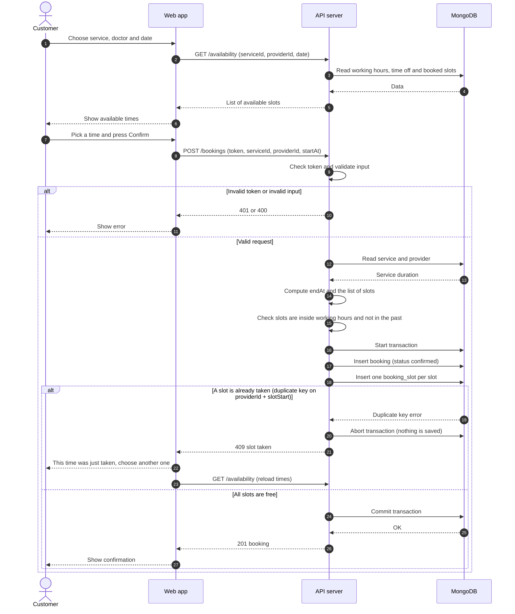
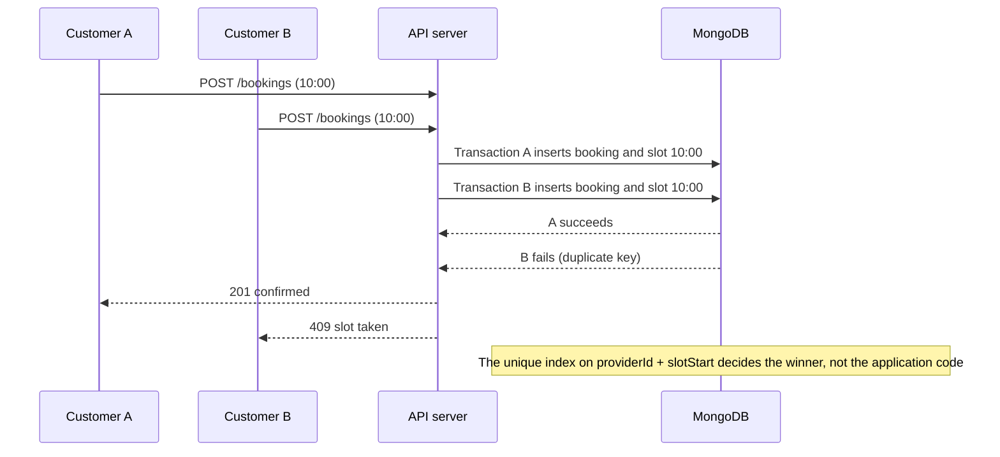

# Booking Sequence Diagrams

How a booking is created (FR-9, FR-10, US-5), and how the system stays safe when two customers book the same time.

## 1. Booking flow

## 2. Two customers book the same time

## Design notes

1. **The database has the last word.** Checking availability before inserting is not enough, because two requests can pass the check at the same moment. The unique index on `(providerId, slotStart)` in `booking_slots` makes the second insert fail (risk R1, FR-10, NFR-7).
2. **One transaction.** The booking and all its slots are saved together or not at all, so a failed booking never leaves half-reserved slots behind.
3. **Longer services.** A 60-minute service on a 30-minute grid takes two slots (10:00 and 10:30). A second booking that needs the 10:30 slot fails on the same index, so overlaps are blocked too.
4. **The server calculates everything.** The client sends only `serviceId`, `providerId` and `startAt`. The server computes `endAt`, the slots and the price from its own data (NFR-6).
5. **Clear error for the user.** `409` carries a message the screen can show, then the screen reloads the available times.

## Automated test (NFR-7)

Send 10 booking requests for the same provider and slot at the same time. The test passes only if exactly one request returns `201`, the other nine return `409`, and the database holds exactly one booking and one slot for that time.

## Traceability

| Item | Covered by |
|------|------------|
| FR-8 Available slots | Part 1, steps 1 to 6 |
| FR-9 Book a slot | Part 1, confirm and insert |
| FR-10 No double booking | Unique index and transaction, Part 2 |
| NFR-7 Automated test | Test described above |
| NFR-8 UTC | `startAt` and `endAt` are sent and stored in UTC |

