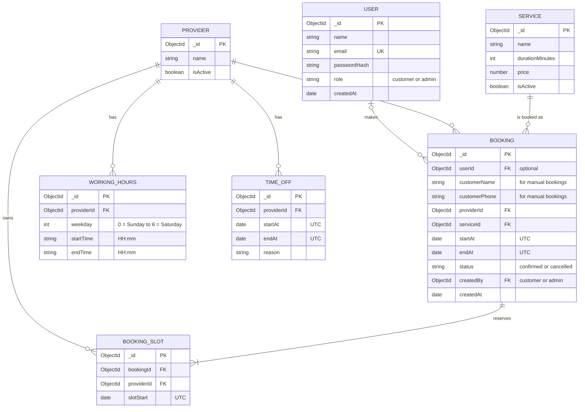

# ER Diagram

Planned database: MongoDB (each entity below is a collection). The stack is confirmed in T16.

## Design decisions

1. **Slot grid:** the clinic works with fixed slots (30 minutes, set in configuration). Every service duration is a multiple of the slot length.
2. **Double-booking protection (FR-10, NFR-7, risk R1):** a booking creates one `BOOKING_SLOT` document per slot it occupies. A unique index on `(providerId, slotStart)` makes it impossible for two bookings to take the same slot, even for services of different lengths. The booking and its slots are created in one database transaction.
3. **Cancelling (FR-11):** the booking status becomes `cancelled` and its slot documents are deleted, which releases the slots.
4. **Manual bookings (FR-15):** `userId` is optional, because a patient who calls by phone may not have an account. In that case `customerName` and `customerPhone` are filled in.
5. **Services (FR-5):** a service is never hard-deleted. The admin sets `isActive = false`, and a service with future bookings cannot be deactivated (US-9).
6. **Providers and services:** in v1 every provider can perform every service. A link table can be added later if needed.
7. **Dates and time zone (NFR-8):** all dates are stored in UTC. The clinic's time zone is a configuration value, not a collection.
8. **Working hours (FR-6):** one document per provider per weekday. Split shifts could be supported later by allowing several documents for the same weekday.

## Indexes

| Collection | Index | Purpose |
|------------|-------|---------|
| users | unique `(email)` | No duplicate accounts (FR-1) |
| booking_slots | unique `(providerId, slotStart)` | No double booking (FR-10) |
| bookings | `(userId, startAt)` | My bookings (FR-13) |
| bookings | `(startAt)` | Admin schedule, filter and search (FR-14, FR-16) |
| working_hours | `(providerId, weekday)` | Calculate available slots (FR-8) |
| time_off | `(providerId, startAt)` | Exclude days off from slots (FR-7, FR-8) |

## Traceability

| Requirement | Entities |
|-------------|----------|
| FR-1, FR-2, FR-3 | USER |
| FR-4, FR-5 | SERVICE |
| FR-6, FR-7, FR-8 | PROVIDER, WORKING_HOURS, TIME_OFF, BOOKING_SLOT |
| FR-9 to FR-13 | BOOKING, BOOKING_SLOT |
| FR-14 to FR-16 | BOOKING, USER, SERVICE |
