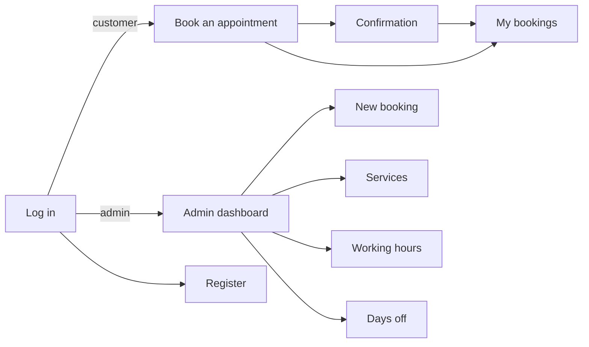

# Wireframes

Low-fidelity sketches of the three main screens. The customer screens are designed for a phone first (NFR-10). The admin dashboard is designed for a desktop screen.

## Screen 1: Log in (FR-2, US-2, US-8)

```
+--------------------------------------+
|  Clinic Booking                      |
+--------------------------------------+
|                                      |
|  Log in                              |
|                                      |
|  Email                               |
|  +--------------------------------+  |
|  | name@example.com               |  |
|  +--------------------------------+  |
|                                      |
|  Password                            |
|  +--------------------------------+  |
|  | ********                       |  |
|  +--------------------------------+  |
|                                      |
|  [ Log in ]                          |
|                                      |
|  New here? Create an account         |
|                                      |
+--------------------------------------+
```

Notes:
- One screen for both roles. After login a customer goes to the booking screen and an admin goes to the dashboard.
- A wrong email or password shows one message that does not say which field is wrong.
- "Create an account" opens the registration form: name, email, password (US-1).

## Screen 2: Book an appointment (US-3, US-4, US-5)

```
+--------------------------------------+
|  Clinic Booking        [My bookings] |
+--------------------------------------+
|                                      |
|  Book an appointment                 |
|                                      |
|  Service                             |
|  +--------------------------------+  |
|  | Check-up (30 min, 20.00)  v    |  |
|  +--------------------------------+  |
|  Doctor                              |
|  +--------------------------------+  |
|  | Dr. Ahmad  v                   |  |
|  +--------------------------------+  |
|  Date                                |
|  +--------------------------------+  |
|  | <   Mon 1 Dec 2026   >         |  |
|  +--------------------------------+  |
|                                      |
|  Available times                     |
|                                      |
|  [09:00] [09:30] [10:00] [10:30]     |
|  [11:00] [11:30] [14:00] [14:30]     |
|  [15:00] [15:30]                     |
|                                      |
|  Selected: Check-up, Mon 1 Dec,      |
|  10:00 - 10:30 with Dr. Ahmad        |
|                                      |
|  [ Confirm booking ]                 |
|                                      |
+--------------------------------------+
```

Notes:
- The service list shows duration and price (US-3).
- Times load after the service, doctor and date are chosen. Only available times are shown (US-4, FR-8).
- If someone books the same time first, the API returns 409. The screen shows "This time was just taken, please choose another one" and reloads the times (FR-10).
- After confirming, the customer sees a confirmation and a link to "My bookings".
- "My bookings" is a simple list of upcoming and past bookings with a Cancel button on upcoming ones (US-6, US-7).

## Screen 3: Admin dashboard (US-11, US-12, US-15)

```
+----------------------------------------------------------------------------+
|  Clinic Admin   [Schedule] Bookings  Services  Hours  Days off    [Logout] |
+----------------------------------------------------------------------------+
|                                                                            |
|  Today: Mon 1 Dec 2026      [<] [>]      [ + New booking ]                 |
|                                                                            |
|  Search patient: [______________]   Status: [All  v]   Date: [________]    |
|                                                                            |
|  +-----------------------------------------------------------------------+ |
|  | Time   Patient        Service      Doctor     Status     Action       | |
|  +-----------------------------------------------------------------------+ |
|  | 09:00  Sara Ali       Check-up     Dr. Ahmad  Confirmed  [Cancel]     | |
|  | 09:30  Omar K.        Follow-up    Dr. Ahmad  Confirmed  [Cancel]     | |
|  | 10:30  Rami (phone)   Check-up     Dr. Lina   Confirmed  [Cancel]     | |
|  | 11:00  Huda M.        Check-up     Dr. Ahmad  Cancelled  -            | |
|  +-----------------------------------------------------------------------+ |
|                                                                            |
|  Showing 4 of 4 bookings                                                   |
|                                                                            |
+----------------------------------------------------------------------------+
```

Notes:
- The first view is today's schedule in time order, so the admin sees the day at a glance (US-11).
- "+ New booking" opens a form for a patient who called by phone: name, phone, service, doctor, time (US-12).
- The search box and filters narrow the list by patient name, date and status (US-15).
- Services, Hours and Days off open the management screens for FR-5, FR-6 and FR-7.

## Navigation flow



## Not drawn yet

Registration, My bookings, Services, Working hours and Days off follow the same layout as the screens above. They will be detailed during implementation.
